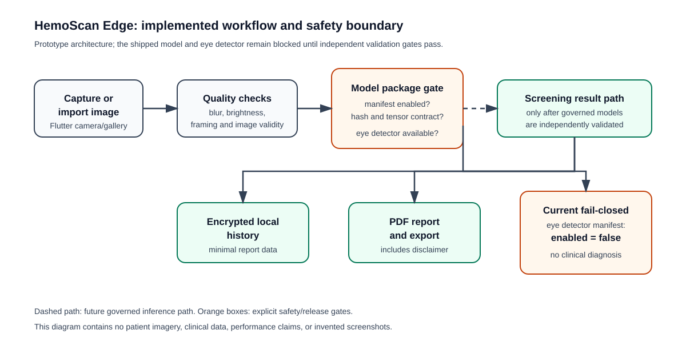

# HemoScan Edge

Offline Flutter prototype for AI-assisted anemia-risk screening from a
palpebral-conjunctiva image, with a Python workflow for governed model
training and evaluation.



The diagram shows the implemented application boundary and the future
validated-inference path. It is an architecture illustration, not a clinical
result or a screenshot of a validated device.

## Safety status

This project is **not a clinically validated diagnostic product**. The app
must not claim that a person has or does not have anemia. The bundled
prototype model and eye detector remain disabled through their manifests until
the release gates in [`docs/RELEASE_READINESS.md`](docs/RELEASE_READINESS.md)
are completed.

The required user-facing message is:

> This application is an AI-assisted screening tool. It cannot diagnose
> anemia. Consult a qualified healthcare professional for laboratory
> confirmation.

No clinical performance metrics are claimed by this repository. Dataset
access, licensing, provenance, patient-level splitting, calibration, external
validation, and out-of-distribution behavior require independent review.

## End-to-end workflow

1. The Flutter app captures an image from the camera or imports one from the
   gallery.
2. Local image checks inspect decodeability, brightness, blur, framing, and
   whether a real eye detector is available.
3. The app reads the model manifests before loading local TFLite assets. It
   checks the enabled flag, SHA-256 integrity value, tensor dimensions, data
   type, and output contract.
4. The current manifests keep both the anemia model and eye detector blocked,
   so unsuitable or unvalidated inference fails closed instead of producing a
   medical-looking score.
5. Screening records can be stored in an encrypted local history and exported
   as a PDF that includes the required non-diagnostic disclaimer.
6. The Python workflow trains and evaluates models only from reviewed metadata
   with patient-level grouping. It supports held-out, external, subgroup,
   calibration, and predictive-entropy/OOD reporting.

## Current implementation status

| Area | Status |
| --- | --- |
| Flutter app shell, camera/gallery flow, and screening UI | Implemented |
| Image validity, blur, brightness, and eye-detector safety boundary | Implemented; eye detector remains unavailable |
| Local TFLite loader, manifest validation, hash and tensor-contract checks | Implemented; model is disabled by manifest |
| Encrypted local history and PDF export | Implemented |
| Patient-level training split and model export workflow | Implemented as research tooling |
| Clinical validation, calibration, external testing, and OOD approval | Not completed |
| Production model release or diagnostic use | Not approved |

## Model and runtime boundary

The app is designed for an offline, two-stage package: a real eye/lower-eyelid
detector followed by an anemia-risk classifier. The Flutter runtime uses
`tflite_flutter` and loads assets only after the JSON manifest and integrity
checks pass. The bundled TFLite file is retained as a development artifact,
but `anemia_app/assets/model_manifest.json` sets `enabled` to `false`; the eye
detector manifest is also disabled. Therefore the repository currently
demonstrates the governed loading boundary and fail-closed behavior, not a
validated screening capability.

## Repository layout

| Path | Purpose |
| --- | --- |
| [`anemia_app/`](anemia_app/) | Flutter application and safety-gated local inference boundary |
| [`anemia_model/`](anemia_model/) | Training, evaluation, export, and attribution scripts |
| [`docs/`](docs/) | Engineering, privacy, dataset, and release-readiness documentation |

Clinical datasets, path-bearing metadata, virtual environments, generated
build output, and training checkpoints are intentionally excluded from Git.
Obtain data only under terms that permit the intended research use and create a
reviewed metadata CSV before running training.

## Flutter development

From `anemia_app` on Windows:

```powershell
flutter pub get
flutter analyze
flutter test
```

The tests cover app startup and fail-closed behavior when no validated eye
detector is available. Device and integration testing require a configured
Flutter target.

## Model workflow

From `anemia_model`, create an environment using the requirements appropriate
to the task:

```powershell
python -m venv .venv
.venv\Scripts\Activate.ps1
python -m pip install -r requirements-training.txt
python scripts\train_screening_model.py --metadata-csv path\to\metadata.csv
```

The metadata CSV must contain `image_path`, `patient_id`, and `hb_g_dl`.
Training derives labels from the supplied hemoglobin threshold and splits by
patient, not by image. See [`anemia_model/README.md`](anemia_model/README.md)
and [`docs/ENGINEERING_BLUEPRINT.md`](docs/ENGINEERING_BLUEPRINT.md) before
using clinical data.

## Prioritized future improvements

1. **Complete data governance first:** archive dataset terms, provenance,
   de-identification review, checksums, and a data dictionary before using any
   clinical images or redistributing a model.
2. **Train and validate the eye detector:** use labeled positive and unsuitable
   images with patient-level splits, then evaluate rejection behavior on a
   locked test set.
3. **Establish clinical model evidence:** report sensitivity, specificity,
   precision, F1, ROC-AUC, calibration/Brier score, confidence intervals,
   subgroup results, and external site/device performance.
4. **Verify runtime parity:** compare the reference model and TFLite outputs,
   review the manifest hash and tensor contract, and keep the release flag
   disabled until an independent reviewer signs off.
5. **Harden app release quality:** add device-level camera/gallery tests,
   accessibility review, temporary-image deletion checks, export redaction
   tests, and an offline permission/network audit.
6. **Improve maintainability:** move remaining presentation-layer inference
   orchestration behind the existing repository interfaces and add focused
   unit tests for manifest parsing, validation gates, and report persistence.

The complete release checklist is in
[`docs/RELEASE_READINESS.md`](docs/RELEASE_READINESS.md); the engineering
decisions and threat-model notes are in
[`docs/ENGINEERING_BLUEPRINT.md`](docs/ENGINEERING_BLUEPRINT.md).

## Publication boundary

This folder is the authoritative source selected from the surrounding
`Innovation` copies. The existing public GitHub repository was updated only
after explicit approval; no new repository was created and no visibility
change was made.
