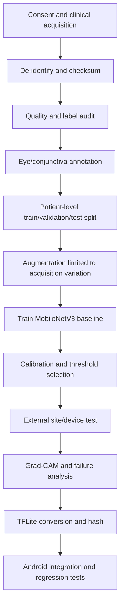
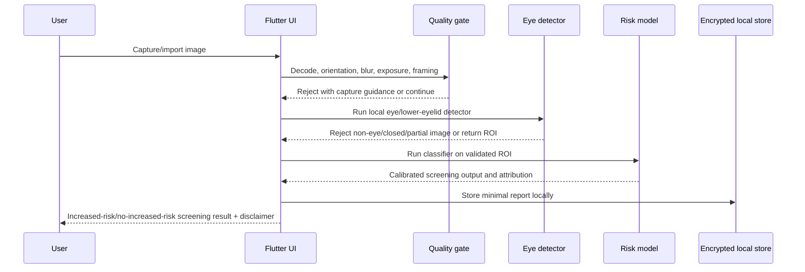

# HemoScan Edge engineering blueprint

## Safety boundary

HemoScan Edge is an offline, AI-assisted **screening** prototype. It must not
diagnose anemia, estimate a laboratory hemoglobin value, or replace a qualified
healthcare professional. The required user-facing statement is:

> This application is an AI-assisted screening tool. It cannot diagnose
> anemia. Consult a qualified healthcare professional for laboratory
> confirmation.

The current bundled model and the current eye detector are blocked. The app
must fail closed until a governed model package is installed. A probability
from an unvalidated model is not a clinical confidence score.

## Dataset decision record

| Candidate | Verified evidence | License/access | Strengths | Limitations and decision |
|---|---|---|---|---|
| Eyes-defy-anemia, IEEE DataPort, DOI `10.21227/t5s2-4j73` | 218 eye/conjunctiva images; laboratory Hb, age and sex; Indian and Italian cohorts; manual palpebral/forniceal masks | Free research access is described, but no permissive SPDX license is stated on the page; obtain and archive the DataPort terms before redistribution | Directly matches the intended palpebral-conjunctiva use case; masks support segmentation and Grad-CAM sanity checks | Small, device-standardized acquisition, missing Hb for at least one patient, and limited population/device diversity. Suitable for pipeline prototyping and external comparison, not sufficient alone for deployment |
| Multimodal conjunctiva/palm/nail-bed dataset, IEEE DataPort, DOI `10.21227/n7km-nr64` | 1,485 participants; 166 anemic and 1,318 non-anemic by the page's WHO Hb `<12 g/dL` definition; lab Hb range 6.0–18.7 g/dL | Access terms are DataPort-specific; license must be reviewed before use | Participant identifiers align images and lab labels; multiple modalities enable ablation and leakage checks | Strong class imbalance, one Indian collection site, and multiple images per participant. Use patient-level splits and report site/device limitations |
| ImageHB, `bdtd.github.io/ImageHB` | 27,259 labelled clinical images from 4,430 paediatric subjects; conjunctiva, palm, tongue and nailbed; correlated anthropometric and laboratory data; selected segmentation masks | Public landing page does not itself state a redistribution license; obtain the dataset terms and provenance | Largest candidate and includes paediatric laboratory metadata and masks | Population is paediatric and multimodal; not a direct adult deployment proxy. Useful for pretraining/segmentation and subgroup evaluation, not a stand-alone target dataset |

No dataset should be called “clinically reliable” solely because it is public or
peer-reviewed. Before training, archive the downloaded terms, the source
version, checksums, ethics/provenance information, patient identifier policy,
and a data dictionary. Do not combine datasets until label definitions,
camera characteristics, and permission terms are reconciled.

## Model selection

| Architecture/runtime | Role | Decision |
|---|---|---|
| MobileNetV3-Small + TensorFlow Lite | Main candidate for 224x224 RGB screening | Preferred first baseline: low parameter count, mature Android CPU/GPU delegates, and simple Flutter integration |
| EfficientNet-Lite0 | Accuracy-oriented alternative | Benchmark against MobileNetV3; use if the external test set improves without unacceptable latency |
| ResNet50 | Research baseline | Too large for the first rural-device target; useful for a capacity comparison |
| ConvNeXt | Research upper bound | Not the first edge target; benchmark offline on the same split |
| Vision Transformer | Research/representation model | Requires more data and tuning; do not choose from small datasets without external validation |
| YOLO | Detection/ROI stage only | Appropriate for locating the lower eyelid when a real, annotated detector exists; not the anemia classifier |
| ONNX Runtime | Alternative runtime | Consider only if a validated detector/classifier cannot be exported reliably to TFLite |

The app should use a two-stage package: a real eye/lower-eyelid detector, followed
by a real anemia-risk classifier. Both models require versioned manifests,
SHA-256 hashes, input/output contracts, and a rejection path.

## End-to-end ML pipeline



Required evaluation includes accuracy, precision, recall/sensitivity,
specificity, F1, ROC-AUC, confusion matrix, calibration curve/Brier score,
confidence intervals, subgroup results, and cross-validation at the patient
level. Report the chosen operating threshold and its reason. Never report
random confidence values or metrics from a leaked image-level split.

## Runtime flow



## Flutter target structure

```text
lib/
  core/
    errors/
    logging/
    security/
  features/screening/
    data/
      local_model_data_source.dart
      screening_repository_impl.dart
    domain/
      screening_repository.dart
      screening_result.dart
      use_cases/
    presentation/
      capture_screen.dart
      result_screen.dart
      screening_controller.dart
  features/history/
  features/reports/
  services/
    camera/
    image_quality/
    eye_detection/
    inference/
```

Use Riverpod or Bloc consistently, inject repositories and interpreters, and
keep UI unaware of TFLite tensor details. The current repository is being
migrated incrementally; the first safety-critical boundary is the model
manifest and fail-closed validation.

## Privacy and security checklist

- No network permission, analytics SDK, cloud upload, or background sync in the
  offline release.
- Store only the minimum report data; encrypt local records with a device-kept
  key and delete temporary image files after inference.
- Do not put patient names or contact details in logs.
- Validate model manifest, tensor shape, dtype, version, and SHA-256 before use.
- Handle camera/gallery permissions only at point of use.
- Add export confirmation and redact identifiers by default.
- Threat-model rooted devices, backup extraction, screenshots, and shared
  storage.

## Competition positioning

The strongest SEVA FIRST claim is not “diagnosis without blood.” It is an
affordable, offline, privacy-preserving **screening workflow** with explicit
rejection of unsuitable images, transparent model governance, rural-device
constraints, and a referral recommendation for confirmatory laboratory testing.
Clinical validation, regulatory classification, and deployment claims remain
future work until a prospective protocol is completed.
